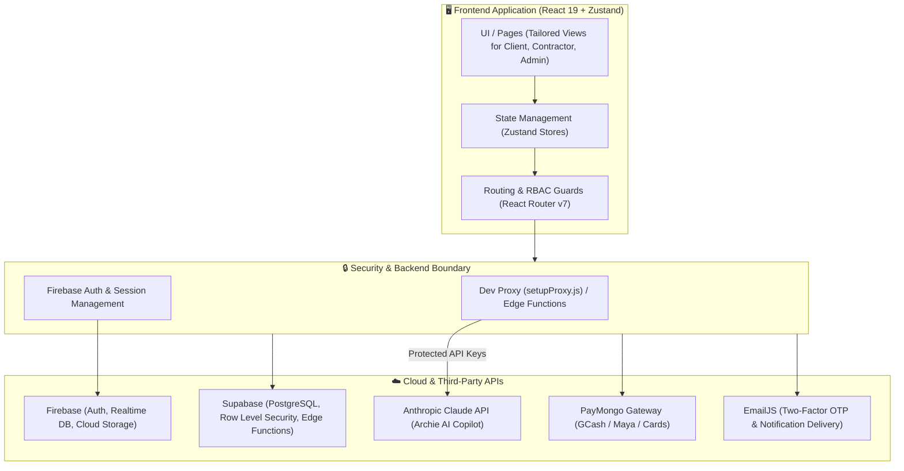

# 🏗️ BuildBid PH (PH-Bid)

<div align="center">


**A Modern, Transparent Bidding & Project Management Platform for the Philippine Construction Industry**

[](https://react.dev/)
[](https://github.com/pmndrs/zustand)
[](https://firebase.google.com/)
[](https://supabase.com/)
[](https://www.anthropic.com/)
[-00C853?style=flat-square)](https://www.paymongo.com/)
[](LICENSE)
[](https://github.com/afighi/PH-Bid/pulls)

[Key Features](#-key-features) • [Architecture](#-architecture--tech-stack) • [Security](#-security--credentials-management) • [Getting Started](#-getting-started) • [Environment Config](#-environment-variables) • [User Roles](#-user-roles--access-control)

</div>

---

## 📖 Overview

The Philippine construction and contracting industry has historically faced significant challenges: fragmented communication, opaque pricing, delayed payments, and unvetted contractors. 

**BuildBid PH** is an end-to-end digital procurement and project management solution built to modernize and secure construction workflows in the Philippines. It connects property owners (**Clients**) with verified builders and tradespeople (**Contractors**) within an escrow-protected, milestone-driven bidding ecosystem, assisted by **Archie AI**—an intelligent construction cost and planning copilot.

---

## ✨ Key Features

### 👤 Client Portal
- **Project Posting Wizard**: Structured project creation with budget allocation, scope breakdown, blueprints, and schedule requirements.
- **Bid Comparison & Analytics**: Review competitive proposals side-by-side with itemized material/labor costs, contractor portfolios, and reviews.
- **Milestone Management & Escrow**: Authorize payments that stay protected in escrow until project milestones are verified and completed.
- **Change Order Workflow**: Formalized approvals for scope modifications to prevent unexpected budget escalations.

### 🔨 Contractor Hub
- **Opportunity Discovery**: Browse vetted residential, commercial, and renovation projects filtered by region, budget, and category.
- **Structured Bid Submissions**: Craft detailed bids using reusable templates, timeline commitments, and milestone schedules.
- **Earnings & Pipeline Analytics**: Real-time tracking of active bids, awarded contracts, pending disbursements, and revenue.
- **Public Directory & Showcase**: Verifiable portfolio showcases featuring past project galleries, verified ratings, and credentials.

### 🤖 Archie AI — Construction Copilot
- **Intelligent Cost Estimation**: Context-aware construction cost and quantity estimation tailored for Philippine market prices.
- **Scope & Specification Refinement**: Helps clients draft thorough project requirements to reduce contractor ambiguity.
- **Material Suggestions & Standards**: Advises on structural recommendations and local construction best practices.

### 💳 Localized Escrow & Payment Gateway
- **Philippine Payment Rails**: Built-in support for GCash, Maya, GrabPay, and credit/debit cards via **PayMongo**.
- **Transparent Ledger**: Itemized transaction logs, dispute records, and receipt generation for every milestone disbursement.

### ⚖️ Dispute Management & Auditability
- **Integrated Dispute Mediation**: Structured mediation workflows for milestone disagreements, scope adjustments, or cancellations.
- **Complete Audit Trail**: Immutable logging of project changes, bids, contracts, and message interactions.

---

## 🏛️ Architecture & Tech Stack



### Core Technologies

| Layer | Technologies |
|---|---|
| **Frontend Framework** | [React 19](https://react.dev/) with [React Router v7](https://reactrouter.com/) |
| **State Management** | [Zustand](https://zustand.docs.pmnd.rs/) with localStorage persistence |
| **Styling & Icons** | Vanilla CSS Design System, [Lucide React](https://lucide.dev/), `@fontsource/montserrat` |
| **Validation & Forms** | [React Hook Form](https://react-hook-form.com/) + [Zod](https://zod.dev/) |
| **Authentication & Realtime** | [Firebase Auth & Realtime Database](https://firebase.google.com/) |
| **Database & Edge Functions** | [Supabase](https://supabase.com/) with Row-Level Security (RLS) |
| **AI Engine** | [Anthropic Claude 3.5 Sonnet](https://www.anthropic.com/) via backend proxy |
| **Payment Processor** | [PayMongo](https://www.paymongo.com/) (Philippine payment ecosystem) |
| **Email & Verification** | [EmailJS](https://www.emailjs.com/) with OTP verification flow |

---

## 🔒 Security & Credentials Management

This repository adheres to strict security standards to protect user data, financial flows, and proprietary API keys:

1. **Zero Secret Leaks in Git**:
   - The `.gitignore` file strictly excludes all local environment files (`.env`, `.env*.local`).
   - A sanitized template (`.env.example`) is provided for local and production deployment setups.
2. **Sever-Side Key Isolation**:
   - Sensitive keys (such as `ANTHROPIC_API_KEY` and `PAYMONGO_SECRET_KEY`) are **never bundled in client-side code**.
   - During local development, `src/setupProxy.js` intercepts AI requests to inject keys server-side.
   - In production, calls are routed through serverless **Supabase Edge Functions** with role verification.
3. **Role-Based Access Control (RBAC)**:
   - Route-level route protection (`ProtectedRoute.js`) prevents cross-role access between `client`, `contractor`, and `admin` roles.
4. **Input Sanitization & Schema Validation**:
   - Bids, project creation forms, and user inputs are strictly validated against [Zod](https://zod.dev/) schemas before dispatch.
5. **Two-Factor OTP Security**:
   - Critical account operations utilize email-delivered OTP codes powered by EmailJS.

---

## 🚀 Getting Started

### Prerequisites

Ensure you have the following installed on your machine:
- [Node.js](https://nodejs.org/) (v18.x or v20.x recommended)
- [npm](https://www.npmjs.com/) (v9.x or later) or [yarn](https://yarnpkg.com/)
- Git

### Installation

1. **Clone the repository**:
   ```bash
   git clone https://github.com/afighi/PH-Bid.git
   cd PH-Bid
   ```

2. **Install project dependencies**:
   ```bash
   npm install
   ```

3. **Configure environment variables**:
   Create a local `.env` file by copying the provided example template:
   ```bash
   cp .env.example .env
   ```
   Open `.env` and fill in your service credentials (see [Environment Variables](#-environment-variables) below).

4. **Start the local development server**:
   ```bash
   npm start
   ```
   Open your browser at `http://localhost:3000` to preview the application.

---

## ⚙️ Environment Variables

Copy `.env.example` to `.env` and configure the following parameters:

| Variable | Description | Scope / Exposure |
|---|---|---|
| `REACT_APP_FIREBASE_API_KEY` | Firebase Web API key | Client-safe |
| `REACT_APP_FIREBASE_AUTH_DOMAIN` | Firebase Authentication domain | Client-safe |
| `REACT_APP_FIREBASE_DATABASE_URL` | Firebase Realtime Database URL | Client-safe |
| `REACT_APP_FIREBASE_PROJECT_ID` | Firebase Project identifier | Client-safe |
| `REACT_APP_FIREBASE_STORAGE_BUCKET` | Firebase Cloud Storage bucket name | Client-safe |
| `REACT_APP_FIREBASE_MESSAGING_SENDER_ID`| Firebase Cloud Messaging sender ID | Client-safe |
| `REACT_APP_FIREBASE_APP_ID` | Firebase Web App ID | Client-safe |
| `REACT_APP_EMAILJS_SERVICE_ID` | EmailJS Service identifier for OTPs | Client-safe |
| `REACT_APP_EMAILJS_TEMPLATE_ID` | EmailJS Template identifier | Client-safe |
| `REACT_APP_EMAILJS_PUBLIC_KEY` | EmailJS Public API key | Client-safe |
| `REACT_APP_PAYMONGO_PUBLIC_KEY` | PayMongo public key (`pk_test_...` or `pk_live_...`) | Client-safe |
| `REACT_APP_PAYMONGO_SECRET_KEY` | PayMongo secret key (`sk_test_...`) | ⚠️ Backend/Dev only |
| `ANTHROPIC_API_KEY` | Claude API key for Archie AI copilot | 🔒 Server/Proxy only |
| `REACT_APP_ARCHIE_URL` | Supabase Edge Function URL for Archie in prod | Client-safe |
| `REACT_APP_SUPABASE_URL` | Supabase Project URL | Client-safe |
| `REACT_APP_SUPABASE_ANON_KEY` | Supabase Public Anonymous API key | Client-safe (protected via RLS) |

---

## 👥 User Roles & Access Control

The platform enforces three distinct personas:

```
                  ┌────────────────────────┐
                  │      BuildBid PH       │
                  └───────────┬────────────┘
                              │
          ┌───────────────────┼───────────────────┐
          ▼                   ▼                   ▼
     ┌───────────┐      ┌───────────┐      ┌─────────────┐
     │  Client   │      │Contractor │      │    Admin    │
     └─────┬─────┘      └─────┬─────┘      └──────┬──────┘
           │                  │                   │
  • Post Projects    • Browse Projects    • User Verification
  • Review Bids      • Submit Bids        • Dispute Resolution
  • Fund Milestones  • Track Earnings     • Platform Audits
  • Rate Contractors • Manage Portfolio   • Financial Oversight
```

---

## 📁 Project Structure

```
ph-bid/
├── public/                 # Static web assets & HTML template
├── src/
│   ├── components/
│   │   ├── admin/          # Admin moderation & oversight views
│   │   ├── auth/           # Login, registration, OTP, route guard
│   │   ├── client/         # Client project creation & bid review
│   │   ├── contractor/     # Bid submission, earnings, project discovery
│   │   ├── landing/        # High-conversion public landing page
│   │   ├── layout/         # Navigation, footers, and app chrome
│   │   ├── public/         # Public contractor directory & profiles
│   │   └── shared/         # Messaging, disputes, contracts, settings
│   ├── config/             # Third-party SDK client initializations
│   ├── hooks/              # Custom reusable React hooks
│   ├── services/           # API services (PayMongo, Archie AI, Supabase, etc.)
│   ├── stores/             # Zustand global state stores (auth, project, etc.)
│   ├── utils/              # Formatters, currency helpers (PHP), validators
│   ├── App.js              # Application routing & root providers
│   ├── index.js            # Web application entrypoint
│   ├── setupProxy.js       # Secure development proxy for sensitive APIs
│   └── theme.js            # Design tokens, color system, typography
├── .env.example            # Safe environment template with dummy values
├── .gitignore              # Strict ignore rules for secrets and build artifacts
├── package.json            # Scripts & dependencies
└── README.md               # Project documentation
```

---

## 🛠️ Available Scripts

In the project root, you can run:

- `npm start` — Runs the application in development mode with HMR at `http://localhost:3000`.
- `npm run build` — Compiles and optimizes assets for production into the `build/` folder.
- `npm test` — Executes test suites in interactive watch mode.
- `npm run eject` — Customizes Create React App configuration (one-way operation).

---

## 🗺️ Roadmap

- [ ] **PCAB License Verification**: Automated verification for Philippine Contractors Accreditation Board licenses.
- [ ] **Interactive 3D / BIM Viewer**: In-browser preview of CAD/BIM models for architectural bids.
- [ ] **Progressive Web App (PWA)**: Offline job-site photo uploads and milestone sync for remote areas.
- [ ] **Automated BIR Compliance**: Tax computation and automated electronic receipt generation.

---

## 📄 License

This project is licensed under the **MIT License** — see the [LICENSE](LICENSE) file for details.

---

## 👨‍💻 Author & Contact

**Developed by [afighi](https://github.com/afighi)**  
- GitHub: [@afighi](https://github.com/afighi)  
- Repository: [https://github.com/afighi/PH-Bid](https://github.com/afighi/PH-Bid)

*Constructed with precision for the modern Philippine construction sector.*
